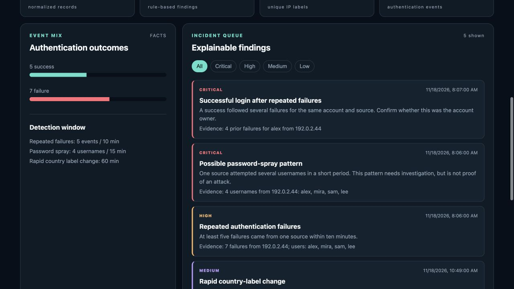

# LogSentinel



LogSentinel is a privacy-first browser dashboard that turns authentication-event
data into explainable defensive review signals. It is intentionally built around
a synthetic dataset so the complete analysis can be demonstrated without
publishing real student, account, or network data.

## Problem addressed

Individual login events are difficult to interpret in isolation. Repeated
failures, one source trying several usernames, a success after failures, and a
rapid country-label change may deserve attention. LogSentinel groups those
patterns while keeping facts separate from inference.

## Features

- Local JSON and CSV import; no server, analytics, cookies, or external APIs
- Sliding-window brute-force and password-spray rules
- Success-after-failures, off-hours, and country-label-change context
- Severity filtering, event-mix bars, and JSON report export
- Synthetic records using documentation-only IP ranges
- Eight automated unit tests and GitHub Actions

## Architecture and stack

The project uses dependency-free HTML, CSS, and JavaScript. `analyzer.js`
normalizes records and applies deterministic rules. `app.js` renders findings
with DOM text nodes and handles local file import/export. The source data stays
in browser memory.

Expected columns are `timestamp`, `source_ip`, `username`, `outcome`, `country`,
and optional `id` and `service`. Outcomes must be `success` or `failure`.

## Run and test

```bash
python3 -m http.server 8000
npm test
```

Open `http://127.0.0.1:8000` and select **Load synthetic dataset**. Verified
result for this release: **8 tests passed**.

## Security model and limitations

See [SECURITY.md](SECURITY.md). This is a learning and triage tool, not a SIEM,
IDS, attribution system, or automated response system. Country labels are
unverified input. The rules do not prove compromise, malicious intent, physical
location, or impossible travel. Browser memory and downloaded reports remain
the user's responsibility.

## Future improvements

- User-configurable detection windows with saved local presets
- A timeline visualization for overlapping patterns
- Streaming parsing for larger local files
- Schema mapping and accessible chart tests
- Optional, separately consented enrichment with explicit privacy controls

## AI-assisted development disclosure

OpenAI Codex generated the initial application, rules, tests, interface, and
documentation. The repository owner must review, understand, and modify the
work before describing personal technical contributions. No independent coding
claim, real-world incident discovery, user count, or deployment impact is
implied.

## License

[MIT](LICENSE)

